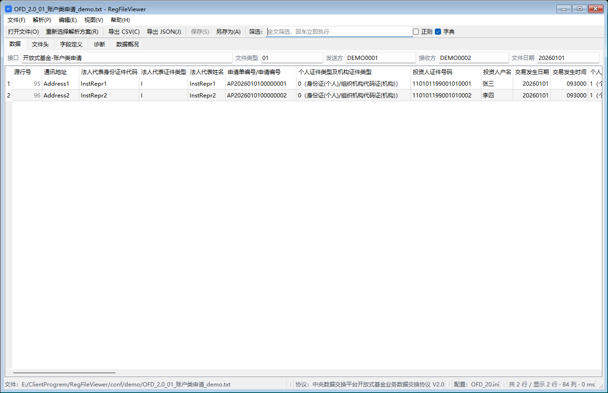

# RegFileViewer

中登（中国结算）开放式基金数据交换协议 **V2.0 / V2.1 / V2.2** 与理财登（银行业理财登记托管中心）定长数据文件的桌面阅读工具。

使用 **Qt 5.15.2 + C++17** 独立实现，面向 Windows 7 SP1 及以上系统，可运行于 32/64 位 Windows（本工程默认 64 位）。



---

## 一、项目来源

本项目在选型阶段参考了开源项目 **FFReader**：

- 仓库：<https://gitee.com/cnldw/FinanceFileReader>
- 作者：幻舞奇影（刘德位）
- 许可：LGPL-3.0

FFReader 是一个成熟的接口文件阅读器，采用「主程序 + 配置分离」架构。本项目的 **程序代码完全重新实现**，但复用了其 `conf/` 目录下的接口字段定义与字典数据（这些 INI 文件按 LGPL-3.0 授权使用，详见 [THIRD_PARTY_NOTICES.md](THIRD_PARTY_NOTICES.md)）。这样既避免重复整理数百个接口字段，又能保证字段偏移、长度、小数位与行业实际文件一致。

## 二、支持的协议与文件

| 协议 | 版本 | 文件形态 | 配置 |
| --- | --- | --- | --- |
| 中央数据交换平台开放式基金业务数据交换协议 | V2.0 | OFD 定长（`OFDCFDAT` 开头） | `OFD_20.ini` |
| 中央数据交换平台开放式基金业务数据交换协议 | V2.1 | OFD 定长 | `OFD_21.ini` |
| 中央数据交换平台开放式基金业务数据交换协议 | V2.2 | OFD 定长 | `OFD_22.ini` |
| 理财产品中央数据交换平台数据交换协议 | V1.0 / V1.1 | 定长（`WDEP` 开头） | `FIXED_WDEP_*.ini` |
| 理财登信息披露数据接口 | V1.0 / V1.1 | 定长（`WPID` 开头） | `FIXED_WPID_理财登信息披露.ini` |
| 内部清算文件（竖线分隔） | 自动识别 | 元数据行 + 中文表头 + `|` 数据行 | 无需配置 |

`OFD_22.ini` 中同时包含集中备份（003）、商业养老金（007）等协议分支，可在「选择解析方案」窗口中手动指定。

> 《中国结算开放式基金新版系统管理人数据接口规范》（OFD 1.0/1.1/1.2）同样受支持：只要把 `OFD_10.ini`、`OFD_11.ini`、`OFD_12.ini` 放入 `conf/`，程序启动时会自动加载，无需改代码。

## 三、功能

- **自动识别**：根据首行标识、版本行、文件类型自动匹配解析方案。
- **内部清算文件**：自动识别“元数据行 + 中文表头 + 竖线数据行”的文件，在**独立窗口**中打开；支持同样的编辑、行复制、保存、另存为与 CSV/JSON 导出，保存时保留元数据行、表头、行尾和编码。
- **智能择优**：多套配置同时命中时，用文件头字段名与配置字段名逐位比对打分；只有一套明显最匹配才自动选中，结构完全相同的方案仍交给用户确认，并在选择窗口中显示「字段匹配 122/122」等参考值。
- **大文件浏览**：按原始字节惰性切片，不预先展开所有字段；十万行级文件可快速打开。
- **字典翻译**：内置业务代码、证件类型、产品状态等枚举字典，可一键开关。
- **全文筛选**：普通关键字 / 正则表达式两种模式，实时显示命中行数。
- **单元格编辑**：双击单元格即可修改；支持整行复制/粘贴、复制选中行、在末尾添加空白行，新增行可一并写回文件。
- **保存 / 另存为**：`Ctrl+S` 按定长规则写回接口文件（保留报文头、行尾、文件尾与编码），`Ctrl+Shift+S` 另存为新文件；新增/复制行会一并写入并更新记录数声明，完全空白的新增行不会写入。
- **信息栏与状态栏**：表格上方显示接口、文件类型、发送方、接收方、文件日期；底部状态栏显示文件完整路径、协议、配置文件。
- **数据概况页签**：集中展示协议版本、记录数、字段数、行长度、编码、结束标识、耗时、当前列数、修改数量等。
- **字段详情**：右键“查看字段详情”可看字段类型、长度、小数位、字典项与源行号。
- **多种导出**：CSV（UTF-8 BOM，可直接双击用 Excel 打开）、JSON（含字段元数据，适合程序处理）。
- **诊断信息**：自动检查记录数、字段数、字段名漂移、行长度、结束标识，并给出中文提示。
- **其他**：拖拽打开、最近文件、列宽自适应、Ctrl+C 复制、文件头/字段定义独立页签。

## 四、构建

### 4.1 环境

| 组件 | 版本要求 | 说明 |
| --- | --- | --- |
| Qt | **5.15.2 MSVC2019 64-bit** | Windows 7 的最后一个官方 Qt 版本 |
| 编译器 | **MSVC 2019（v142）** | 发布 Win7 版本必须使用；VS2022 的 v143 也能编译（见 4.4） |
| CMake | 3.16+ | |
| Ninja | 可选 | 也可用 Visual Studio 生成器 |

### 4.2 命令行构建

```bat
call "C:\Program Files (x86)\Microsoft Visual Studio\2019\Community\VC\Auxiliary\Build\vcvars64.bat"
cmake -S . -B build -G Ninja -DCMAKE_BUILD_TYPE=Release ^
      -DCMAKE_PREFIX_PATH=C:/Qt/5.15.2/msvc2019_64
cmake --build build
```

生成文件：

```
build/RegFileViewer.exe   主程序
build/rfv_selftest.exe        控制台自检程序
build/conf/                   解析配置（构建后自动复制）
```

### 4.3 Qt Creator

直接用 Qt Creator 打开根目录的 `CMakeLists.txt`，选择 `Desktop Qt 5.15.2 MSVC2019 64bit` 套件即可。

### 4.4 使用 VS2022 默认工具集（v143）时的兼容处理

Qt 5.15.2 的 `qcompilerdetection.h` 把容器比较映射到 `stdext::make_checked_array_iterator`，而 VS2022 较新的 MSVC STL 已经删除了 `stdext`，典型报错：

```
QtCore\qvector.h(960): error C3861: “stdext”: 找不到标识符
QtCore\qvector.h(960): error C2065: “stdext”: 未声明的标识符
```

本工程在 CMake 配置阶段会自动检测当前工具集：

- 有 `stdext`（如 v142）：不启用补丁；
- 没有（如 VS2022 14.40+）：自动通过 `/FI` 强制包含 `src/compat/msvc_stdext_shim.h`，用等价的裸指针实现替代，无需修改 Qt 安装目录。

如果切换了编译器但检测结果未更新，删除 `build/` 后重新执行 CMake 配置即可。

> 再次说明：发布到 Windows 7 请使用 **v142** 工具集构建，v143 构建产物不保证能在 Win7 运行。

## 五、Windows 7 说明

- Qt 5.15.2 官方支持 Windows 7 SP1；Qt 6 不支持 Windows 7，因此本工程固定在 Qt 5.15。
- 请使用 **MSVC 2019 (v142)** 工具集编译，避免引入只有 Win10 才有的 API/运行库。
- 构建后 `windeployqt` 会复制 Qt DLL、`platforms/qwindows.dll` 以及 `vc_redist.x64.exe`；在干净的 Win7 上先安装 VC++ 2015-2019 运行库。
- Win7 需安装 SP1 及 KB2533623 等系统更新（`api-ms-win-core-path-l1-1-0.dll` 相关）。
- 发布前建议在纯净 Win7 SP1 x64 虚拟机中做一次冒烟测试。

## 六、使用

1. 启动后按 `Ctrl+O` 或直接把文件拖入窗口。
2. 若命中多套解析方案（例如同为首行 `OFDCFDAT`、版本 `22`、类型 `01` 的基金与商业养老金配置），会弹出方案选择窗口；双击某行或点击「使用此方案解析」。
3. 顶部筛选框输入关键字，按回车立即筛选；勾选「正则」后按正则表达式匹配。
4. 右侧「数据 / 文件头 / 字段定义 / 诊断 / 数据概况」页签可查看数据、原始文件头、字段清单、异常与统计。
5. 双击单元格修改字段；`Ctrl+S` 保存回接口文件，`Ctrl+Shift+S` 另存为新文件；导出内容为**当前筛选结果**。
6. 点击「源行号」列或行标题可选中整行：`Ctrl+C` 复制整行，`Ctrl+V` 把复制的行**追加到数据末尾**；单选单元格时 `Ctrl+C/Ctrl+V` 为普通单元格复制粘贴，把整行数据粘到单元格会提示“行信息无法写入单元格”。
7. 右键菜单或「编辑」菜单也可**复制选中行**（插入到下方）、**在末尾添加空白行**；新增行会随保存写入并更新记录数，完全空白的新增行不会写入。

常用快捷键：

| 快捷键 | 功能 |
| --- | --- |
| `Ctrl+O` | 打开文件 |
| `Ctrl+R` | 重新选择解析方案 |
| `Ctrl+F` | 聚焦筛选框（Qt 默认行为） |
| `Ctrl+S` | 保存（写回接口文件） |
| `Ctrl+Shift+S` | 另存为 |
| `Ctrl+W` | 自适应列宽 |
| `Ctrl+I` | 显示/隐藏左侧详情面板（也可点面板右上角 ×） |
| `Ctrl+Shift+D` | 复制选中行（插入到下方） |
| `Ctrl+Shift+N` | 在末尾添加空白行 |
| `Ctrl+C` | 复制选中单元格；选中整行时复制整行 |
| `Ctrl+V` | 粘贴单元格；选中整行时把复制的行追加到数据末尾 |

## 七、配置目录

`conf/` 下为 UTF-8 编码的 INI 文件：

- `OFD_*.ini`：OFD 文件（文件名中的数字即文件第二行的版本号）。
  段名格式为 `[文件类型_协议分类]`，例如 `[01_001_FUND]`；`COUNT` 为字段数，`1=类型,长度,小数位,中文名,英文名`。
- `FIXED_*.ini`：字段定长文件。
  段名格式为 `[文件名通配符|版本]`，其中 `?` 匹配一个字符、`*` 匹配任意字符。
- `OFD_Dictionary.ini`：OFD 字典，按协议分组（`[001]`、`[003]` ...），字段英文名映射枚举值。
- `OFD_CodeInfo.ini`：发送方/接收方代码与机构名称。

新增私有接口时，只需把新 INI 放入 `conf/`，无需重新编译。若接口升级导致字段变化，解析时「诊断」页会提示“文件头字段名与解析配置不一致”，此时按新的接口规范调整 INI 即可。

> 注意：中国结算 2026-03-20 发布的 V2.2 修订版增加了「强制赎回类型」等字段。随包配置基于较早版本；遇到新版文件时请以诊断提示为准更新 `OFD_22.ini`。

## 八、示例数据与自检

仓库自带 7 个按协议精确构造的示例文件（`conf/demo/`）：

- OFD 2.0 / 2.1 / 2.2（账户类申请、账户类确认、交易类确认）
- 理财登 WDEP 1.1 账户申请、WPID 1.1 信息披露
- 内部清算 `CGB001_0Z_purchase_20261118.txt`（元数据行 + 中文表头 + 竖线数据行）

运行控制台自检：

```bat
build\rfv_selftest.exe
```

自检会验证：配置加载 → 文件识别 → 字段切片 → 表格模型/筛选 → CSV/JSON 导出 → JSON 结构。
也可以指定文件或目录：`rfv_selftest.exe D:\data\20260101`。

重新生成示例数据：

```bat
python tools\make_demo.py
```

## 九、目录结构

```
RegFileViewer/
├── CMakeLists.txt
├── conf/                     # 接口解析配置（来自 FFReader，LGPL-3.0）
│   ├── OFD_20.ini / 21 / 22
│   ├── OFD_Dictionary.ini
│   ├── OFD_CodeInfo.ini
│   ├── FIXED_WDEP_*.ini
│   ├── FIXED_WPID_理财登信息披露.ini
│   └── demo/                 # 示例数据
├── src/
│   ├── main.cpp
│   ├── core/                 # 与界面无关的解析内核
│   │   ├── encoding.*        # GB18030/UTF-8 解码
│   │   ├── inifile.*         # 轻量 INI 解析（保留 ? * | 段名）
│   │   ├── interface.*       # 字段/接口定义、数值格式化
│   │   ├── configrepository.*# 配置加载与方案匹配
│   │   ├── fileparser.*      # OFD / 定长文件探测与解析
│   │   ├── tablemodel.*      # 表格模型（按需切片的字段视图）
│   │   └── exporter.*        # CSV / JSON 导出
│   └── gui/
│       ├── mainwindow.*      # 主窗口
│       └── choosedialog.*    # 解析方案选择
├── tests/selftest.cpp
├── tools/make_demo.py
├── docs/
└── THIRD_PARTY_NOTICES.md
```

## 十、已知限制与后续可做

- 保存只写回接口字段与新增/复制行；完全空白的新增行会被忽略（避免写入无意义空行）。
- 保存采用原子写入，保留原文件的报文头、行尾风格、BOM 与文件尾；数值字段会按小数位补零，超长会提示错误。
- 未实现 DBF 与通用 CSV（逗号/制表符分隔、带引号转义）文件的读取；分隔符文件目前仅自动识别“元数据行 + 表头 + 竖线数据行”的内部清算文件。解析内核已按「协议 + 布局」抽象，可按需扩展 `Layout` 枚举。
- 筛选为全量扫描，超大文件（百万行）首次筛选会有可感知延迟，可改为后台线程与增量结果。
- 建议后续增加：xlsx 导出（可用 QXlsx）、主键冲突检查、两文件比对、命令行批量导出。

## 十一、许可

- 程序代码：MIT，见 [LICENSE](LICENSE)。
- `conf/` 下的接口配置与字典数据：源自 FFReader，LGPL-3.0，见 [THIRD_PARTY_NOTICES.md](THIRD_PARTY_NOTICES.md)。

## 十二、致谢

感谢幻舞奇影（刘德位）开源 FFReader 并长期维护行业接口配置，为金融行业接口排查工作提供了很大帮助。
